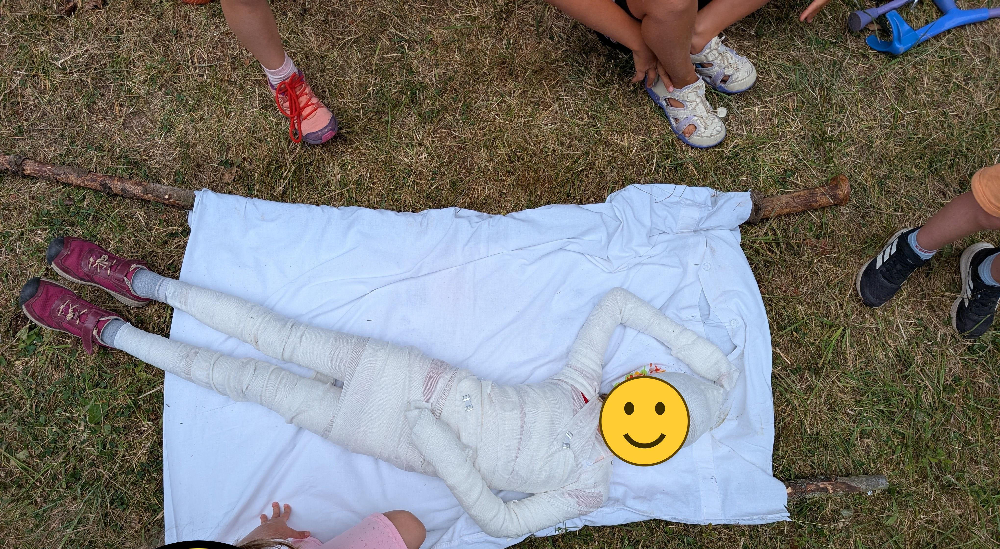
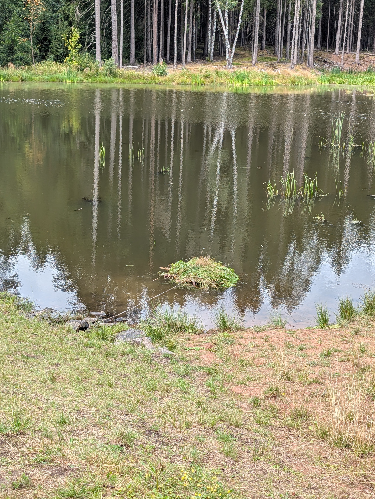
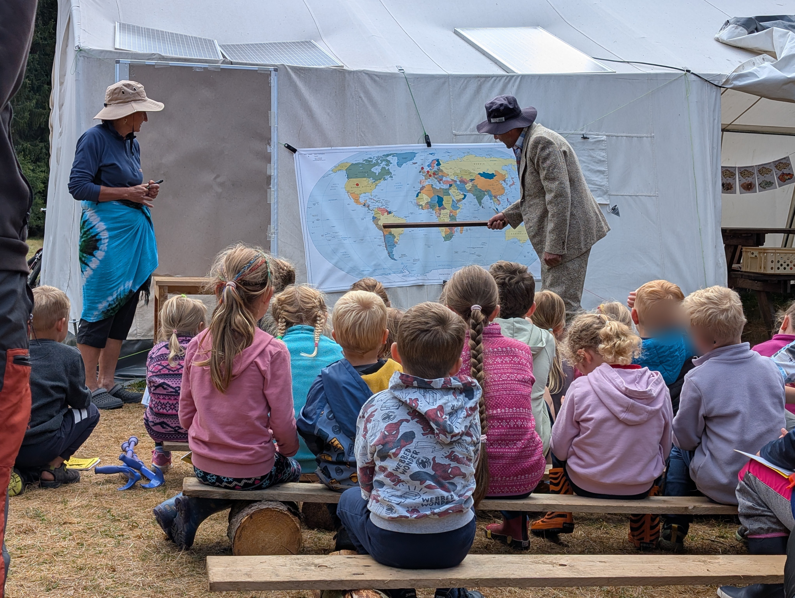
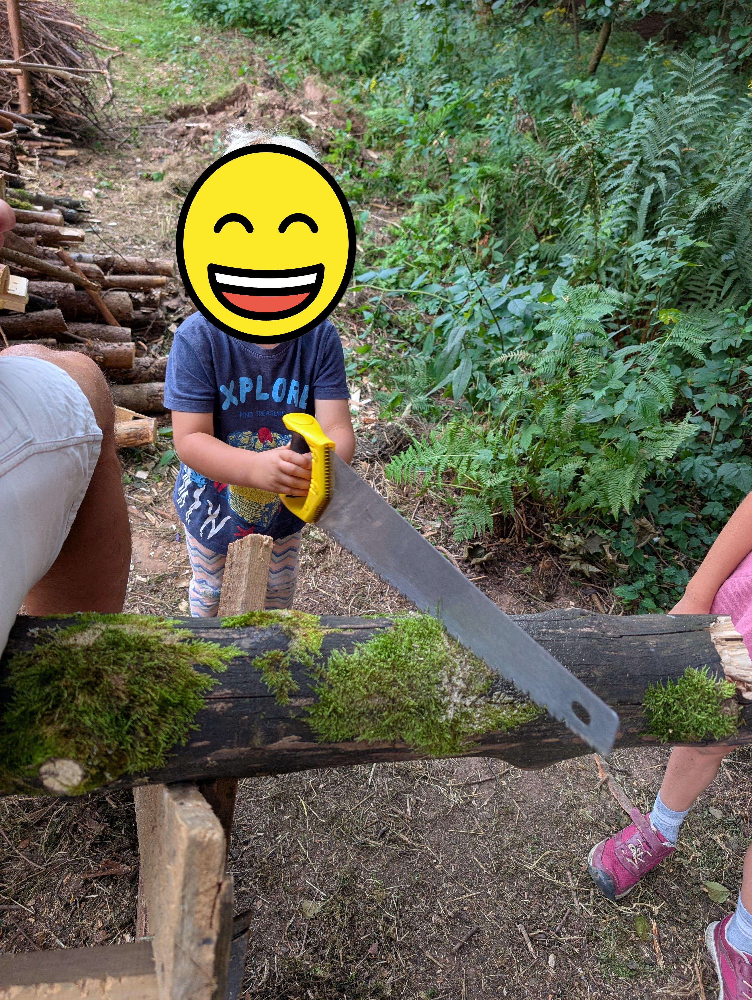
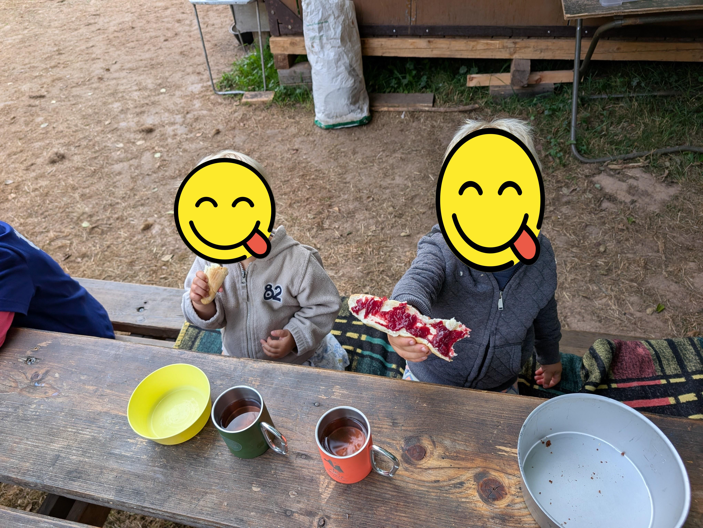

This post is exactly what it says on the tin: a camp run by a group of grandparents, for their own grandkids.

It started because one enthusiastic outdoorswoman was pretty sad to discover that her own kids had no intention of taking their own kids camping anywhere that didn't have a hot shower. So she decided to give her grandchildren that experience herself. It's called "Grandparents with Kids," and it works like it sounds: grandmas and grandpas book a campsite with tents belonging to the Turnov branch of the Czech Tourist Club for seven days and bring their grandkids along.

This year my own kids went too. Granted, plenty of kids go to this camp. Mine, though, were a year and a half and not quite three at the time.

*photo: A campsite with tents on wooden platforms*

## A hiking club that's always off somewhere

Around Turnov, where we live now, there's a seriously strong hiking club. Our kids' grandma and grandpa are constantly heading off somewhere with it: cross-country skiing, cycling, backpacking, via ferratas, several times a year — plus Norway, Sweden, Italy, Austria, pretty much all over Europe. And it's not a small crowd, either; it's usually a decent-sized group. Grandma sometimes complains that the younger members are too slow, and that she and grandpa would actually like to get some real distance in themselves.

I'm deeply grateful for that complaining. The idea that I'll find a crew of people to go everywhere with, kids included, and that one day, once we're old, we'll still be part of an active outdoor community — that sounds wonderful to me.

And it just so happens our kids' grandparents are among this camp's organizers.

## A trip around the world, led by retirees

This year the camp's theme was a trip around the world, and each day was run by a different grandpa-and-grandma pair.

So the kids saw a play performed in Japanese — or at least in the Czech phonetic transcription of Japanese. It was apparently a Japanese take on Hansel and Gretel.

On another day, they climbed the Großglockner. On the way down, following some made-up injuries, they had to treat a team member, wrap them in bandages, and carry them on a stretcher back to base camp. In the photo is our kids' mummified friend, who apparently enjoyed playing the injury victim more than the rest of the expedition put together.

*photo: Our kids' mummified friend on a stretcher*

On the day our cactus-collecting grandpa was running the program, they went to South America. The kids built a raft on the lake, then tried lying down on the ground and assembling themselves into an anaconda faster than the opposing team — whose average age was sixty.

*photo: A raft for crossing a South American lake*

*photo: Our grandpa showing the kids South America*

So it was a completely classic summer camp — the only difference being that the counselors weren't seasoned outdoor types with teenage helpers, but grandparents. A campfire with a guitar in the evening, morning warm-ups in camp T-shirts. I imagine the warm-ups probably aren't run at quite the same pace as at a camp not organized by retirees. Though knowing our grandma and grandpa, it could easily be the exact opposite.

One of the grandmas did the cooking too, and my kids got on extremely well with her.

*photo: Our three-year-old chopping wood*

## How the one-year-old and the three-year-old managed

Since our grandparents have five grandkids — well above average — we decided my husband would go along too, just in case.

Kids come to this camp from a year and a half up to ten years old. Ours additionally had a potty, so they wouldn't have to walk across the whole camp ten times a day, and a stroller for afternoon naps. They slept in smaller Decathlon sleeping bags. Both of them wriggle around a lot in their sleep and tend to climb out of the bag, so they were dressed pretty warmly for the night. In the end, though, they managed brilliantly.

They took part in roughly half the program. It was physically very demanding for them, and my husband eventually figured out it was better to leave them half the day for "normalization" — that is, rest and an unstructured agenda of their own choosing.

*photo: Our one-and-a-half-year-old's balance bike by the campfire*

Their favorite part was breakfast, snack, lunch, snack, and dinner. At mealtimes, apparently, they were always first and left last.

*photo: Camp breakfast*

Our three-year-old got to socialize with other three-year-olds, and my husband, by his own account, also discovered that our kids aren't, compared to everyone else's, crazed little monsters — just pretty ordinary kids for their age.

I'd originally expected my husband and the kids to come back after three days, at best. In the end, I had the whole thing to myself. First day. Second day. Third day. Fourth day. Fifth day. Sixth day… And to my amazement, they made it all the way to the end without me. I don't know if that says more about how great my kids and husband are, or about how I'd overestimated myself thinking neither the kids nor my husband would last a week without me.

So hopefully they'll keep going to this camp for at least another sixty years.
