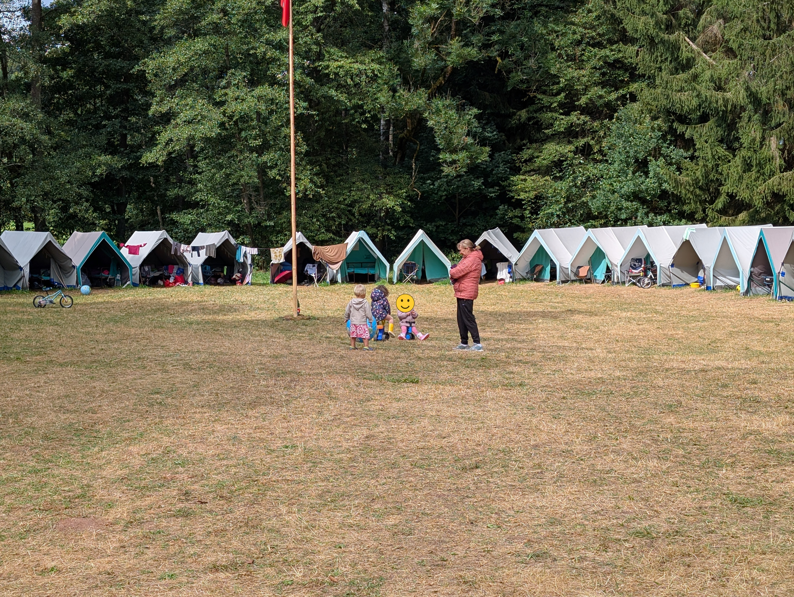
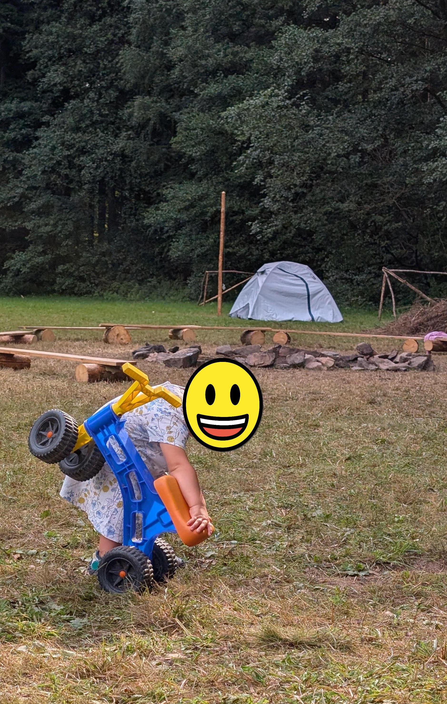

Tenhleten příspěvek bude přesně o tom, co slibuje. O táboře, který organizuje skupina prarodičů pro svá vnoučata.
Tábor vznikl tak, že jedna nadšená outdooristka byla moc smutná, když zjistila, že její děti nehodlají jezdit se svými dětmi na tábor, kde neteče teplá sprcha. A tak se rozhodla, že ten zážitek vnoučatům dopřeje sama. Jmenuje se „Prarodiče s dětmi“ a funguje přesně tak, jak to zní: babičky a dědové si na sedm dní pronajmou tábořiště se stany s dřevěnýma podsadama a vezmou svoje praratolesti s sebou.

Letos na něj jely i moje děti. Což o to, na tábor jezdí spousta dětí. Mým ale bylo v té době rok a půl a necelé tři roky.

*foto: Tábořiště se stany s dřevěnýma podsadama*

## Oddíl, který pořád někam jede

Na Turnovsku, kde teď bydlíme, je obrovsky silný turistický oddíl. Babička s dědečkem našich dětí s ním neustále někam vyrážejí: několikrát ročně na běžky, na kolo, na puťák, na ferraty, do Norska, do Švédska, do Itálie, do Rakouska, zkrátka všude možně po Evropě. A nejede jich málo, většinou je to docela slušná skupina lidí. Babička si občas stěžuje, že ti mladší jsou moc pomalí a že si přece chtějí s dědou taky zajezdit.

Za tohle stěžování jsem moc vděčná. Představa, že si najdu partu lidí, se kterými budeme jezdit všude možně i s dětmi, a že pak jednou, až budeme staří, budeme pořád součástí aktivního outdoorového kolektivu, mi přijde skvělá.

A právě prarodiče našich dětí jsou jedni z organizátorů tohohle tábora.

## Cesta kolem světa, kterou vedou důchodci

Letos měl tábor téma cesty kolem světa a každý den byl v režii jednoho dědečko-babičkovského páru.

Děti tak viděly divadlo v japonštině, nebo přinejmenším v českém fonetickém přepisu japonštiny. Byla to prý japonská obdoba Jeníčka a Mařenky.

Jiný den vyšly na Gross-Glockner. Cestou dolů musely podle fiktivních zranění ošetřit člena týmu, zabalit ho do obvazů a odnést na nosítkách do základního tábora. Na fotce je mumifikovaná kamarádka našich dětí, která si prý roli zraněného užila víc než zbytek výpravy.

*foto: Mumifikovaná sestřenice na nosítkách*

V den, kdy měl program náš dědeček kaktusář, se jelo do Jižní Ameriky. Děti si postavily vor na jezeře a pak se snažily lehnout si na zem a poskládat dohromady anakondu rychleji než protihrající tým, tvořený lidmi s věkovým průměrem šedesát let.

*foto: Vor na přeplavání jihoamerického jezera*

*foto: Náš dědeček ukazuje dětem Jižní Ameriku*

Byl to tedy úplně klasický tábor, jen vedoucí nebyli ostřílení outdooristé s pomocnými puberťáky, ale prarodiče. Večer táborák s kytarou, ráno rozcvička v táborových tričkách. Představuju si, že rozcvička asi není ve stejném tempu jako na táboře, který neorganizují důchodci. Jak ale znám naši babičku s dědečkem, může to být klidně přesně naopak.

Vařila taky jedna babička důchodkyně a moje děti s ní byly extrémně zadobře.

*foto: Náš tříleťák řeže dřevo*

## Jak to zvládly roční a tříletý

Jelikož naši prarodiče mají praratolestí pět, což je výrazný nadprůměr, rozhodli jsme se, že s nimi pro jistotu pojede i můj muž.

Na tábor jezdí děti od roku a půl do deseti let. Ty naše měly navíc proti ostatním nočník, aby nemusely desetkrát denně chodit přes celý tábor, a kočárek na odpolední spinkání. Spaly v menších decathlonových spacáčcích. Obě se ve spánku dost vrtí a mají tendenci ze spacáku vylézat, takže na noc byly oblečené docela dost. Nakonec to ale zvládly výborně.

Programu se účastnily zhruba z poloviny. Fyzicky to pro ně bylo hodně náročné a můj muž časem přišel na to, že je lepší nechat jim půl dne na „normalizaci“, tedy odpočinek a neorganizovaný program podle jejich vlastních představ.

*foto: Odrážedlo naší rokapůlleťačky u ohniště*

Nejradši měly snídani, svačinku, oběd, svačinku a večeři. U jídla prý byly vždycky první a odcházely poslední.

*foto: Táborová snídaně*

Náš tříleťák se mohl socializovat s dalšími tříleťáky a můj muž navíc podle svých slov zjistil, že naše děti nejsou v porovnání s ostatními šílená monstra, ale vlastně docela obyčejné děti na svůj věk.

Původně jsem čekala, že se muž s dětmi vrátí v lepším případě po třech dnech. Nakonec jsem měla volno. První den. Druhý den. Třetí den. Čtvrtý den. Pátý den. Šestý den… A k mému úžasu to zvládli beze mě až do konce. Nevím, jestli to víc svědčí o tom, jak mám skvělé děti a muže, nebo o tom, že jsem měla nos příliš nahoře, když jsem si myslela, že beze mě děti ani muž týden nedají.

Tak snad budou na tábor jezdit minimálně dalších šedesát let.
