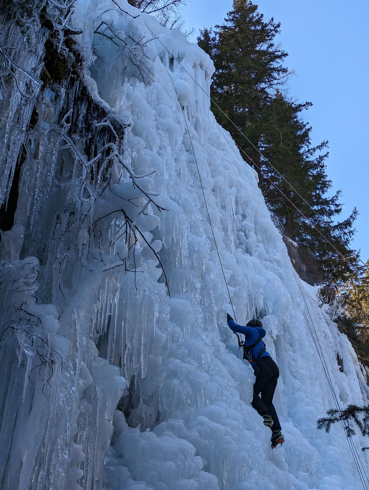
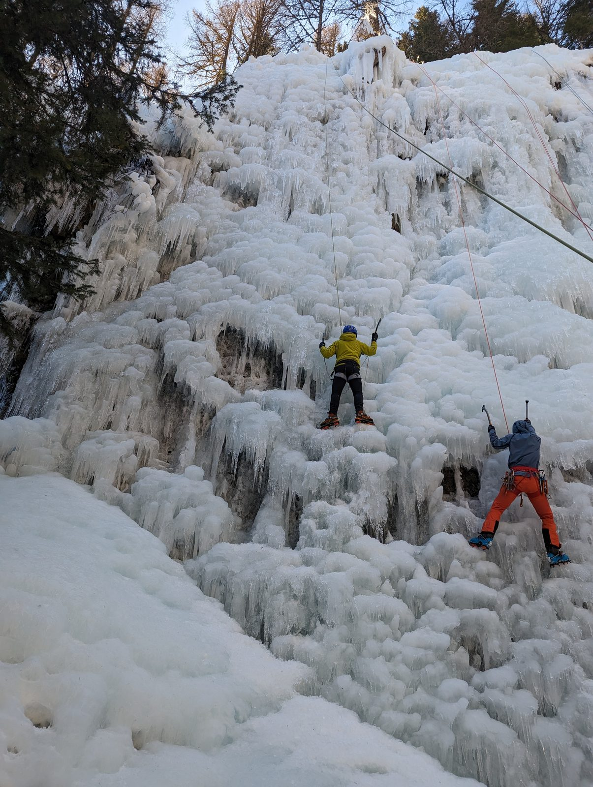
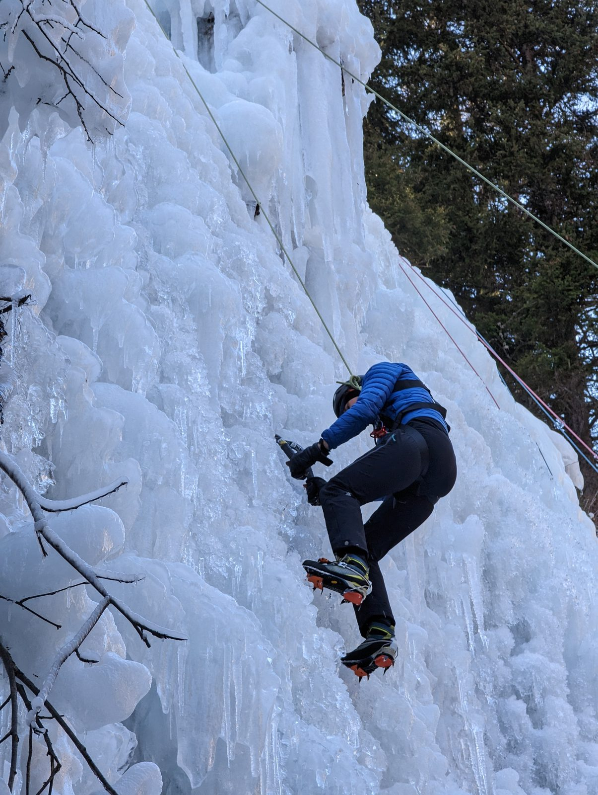
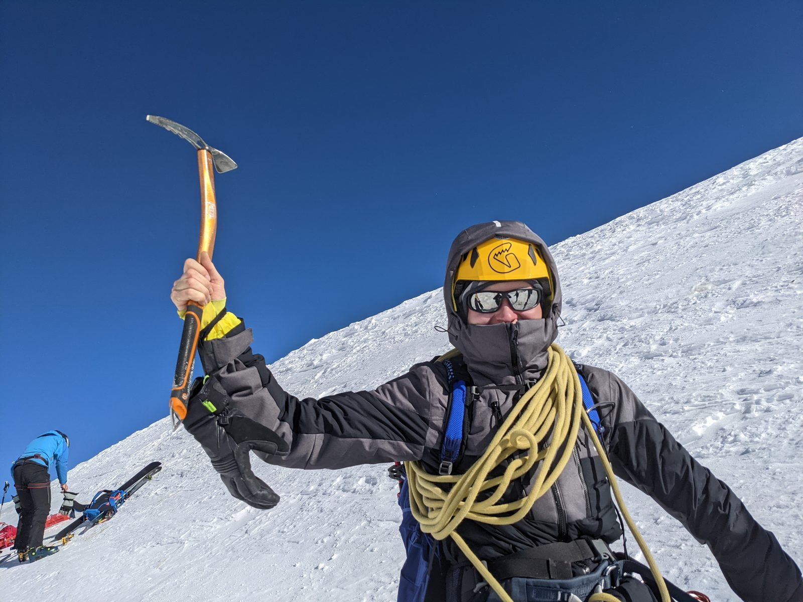
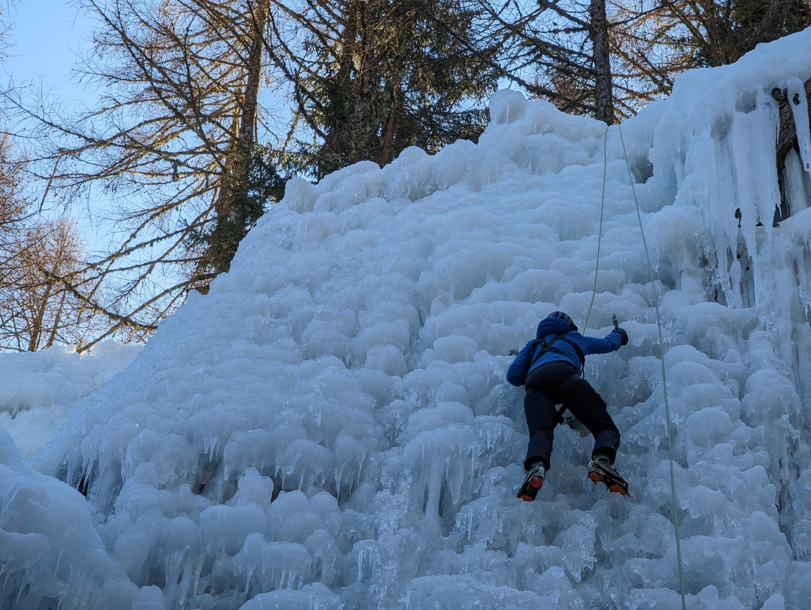
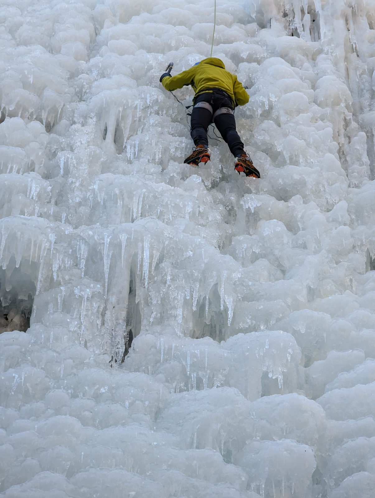
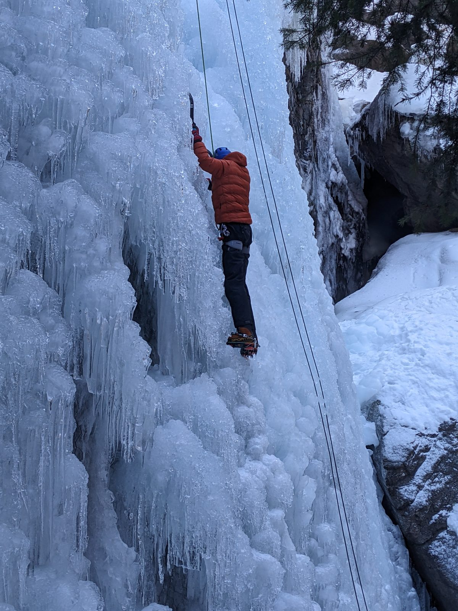
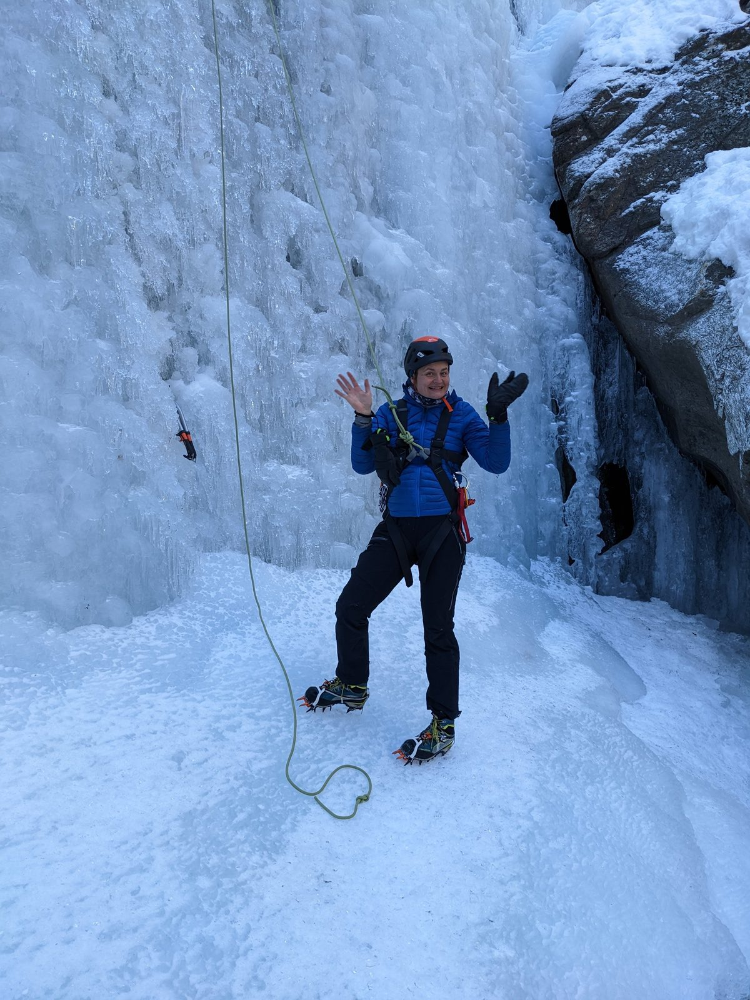

Last time I wrote about [waterfalls](https://vendulasubert.cz/en/outdoor/2026-10-03-falling-for-canyoning/), today it's ice falls.

*photo: Ice, spruce trees, and blue sky – Chamonix in February.*

Ice climbing, as the name suggests, means climbing an ice fall, which is usually a frozen waterfall. On a real, nature-made ice fall, the lead climber places their own protection, most often ice screws, which is slow and completely unsuitable for beginners. I've never actually tried climbing a real frozen waterfall. It's one of those things I have a lot of respect for.

We did try ice climbing on a training wall, though. In the Chamonix valley there are a few spots where French guides spray a section of rock with water in winter and fix anchor rings above it. It's one of the few chances to try ice climbing in relative safety.

*photo: The training wall: our friend on the left, Eda on the right. The anchors up top are tied to trees, so you climb on a top rope.*

## How it's done

Unlike regular climbing, this isn't really about finger technique. You've got crampons on your feet and two ice axes in your hands. You might picture hacking into the ice as hard as you can. In reality, you try not to hack into it at all — you look for pockets you can hook the axe into instead. Swinging with your arm up high above your head is a great recipe for a completely dead arm within a minute.

*photo: Crampons, ice axes — I really wear myself out here: ideally you want your axes higher up, but then sometimes your arms die instead.*

The worst moments for me were when I couldn't find a good spot to hook the axe into. After climbing for a while, my arm would sometimes hurt so much I couldn't even lift it, axe and all. And dropping an axe that isn't leashed to your wrist is a genuinely bad idea for the people below you. Actually, having an axe that isn't leashed to your wrist at all might just be a bad idea, period (sweating-smile emoji).

Eda is definitely better at ice climbing than I am, because he's got way more explosive strength. I can usually only keep up with him in endurance stuff, or swimming. On the ice, I had to rest about twenty times, while he climbed the whole wall in one go :D

## What to wear

Clothing isn't exactly fun either. When you're belaying at the bottom of the wall, you're in the shade and it's often brutally cold. When you're climbing straight up, you sweat fast. Eda and I eventually landed on a two-jacket solution. A base layer, a fleece (a second fleece for some people), thermal long johns, winter trousers with a drawstring, and a lighter down jacket on top. That's what we climb in. Once we're done climbing, we put on proper French jackets and heavy winter cycling gloves, which have a free index finger as well as a free thumb (handy for handling the rope).

And a helmet, of course. Several people climb side by side on the training wall, and chunks of ice fly down every so often.

*photo: This photo isn't actually from ice climbing, it's from Aiguille du Midi. But you can see the proper French jacket I wrap myself in to belay once I'm done climbing. You can also see the heavy-duty cycling glove.*

## On the wall

And then it's just beautiful climbing, from the bottom all the way up.

*photo: Bottom to top.*

*photo: Our friend among the icicles.*

*photo: My brother on the steeper part of the wall.*

We brought one of my brothers along, and he climbed really well. I think he was a little scared, but he didn't let it show.

On the training wall you need to climb carefully: knocking a chunk of ice loose isn't fun for the people below you. If you kick off way more ice than necessary on a wall with lots of people around, the French guides will mark you down as inconsiderate. Toward the end of winter, the wall can also start crumbling on its own. A piece of it once broke off on me right when I was about two and a half meters off the ground, and the rope wasn't taut enough yet, so I fell all the way to the ground. My belayer got a proper scare, since neither of us saw it coming. Which is exactly why I now have even more respect for climbing a real ice fall.

*photo: Back down, all in one piece and happy.*

## Where to go

One of the training walls is [Cascade de glace de Bérard](https://reservation.chamonix-guides.com/reservation-cascade-de-glace-berard.html) in Vallorcine, not far from Chamonix, about a 10-minute walk from the Le Buet train stop. Entry is free, and for 5 euros you can book a spot online. In season it's worth doing, since only 30 people fit there at once, and when it's full, people with a reservation get priority.

You don't need a guide, but you do need your own gear, an 80 m rope, and you need to know how to belay and handle a rope. Boots, crampons, and ice axes can be rented from one of the outdoor shops in Chamonix. A rope and harness are better off being your own, though: with rented protection gear, you never know how whoever used it before you treated it, which is exactly why they're not usually for rent.

So next time you're passing through Chamonix, happy ice climbing!
