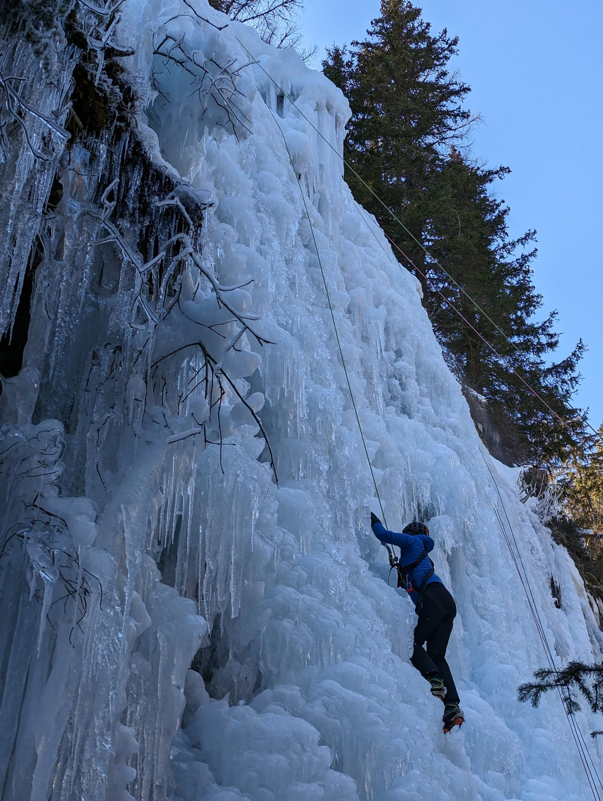
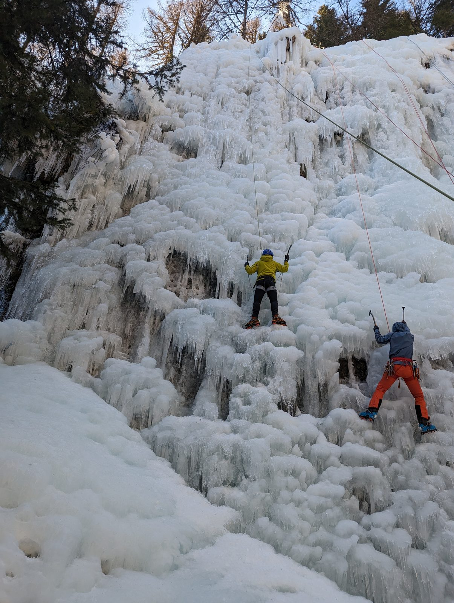
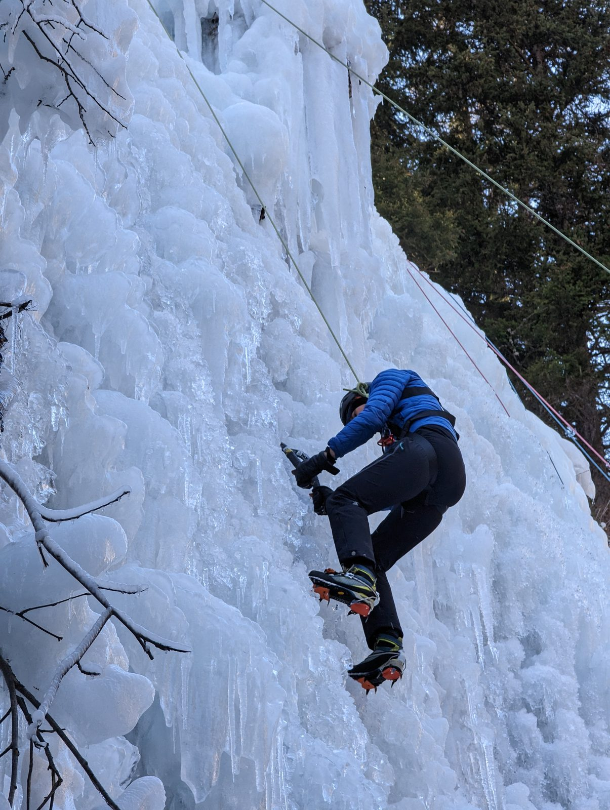
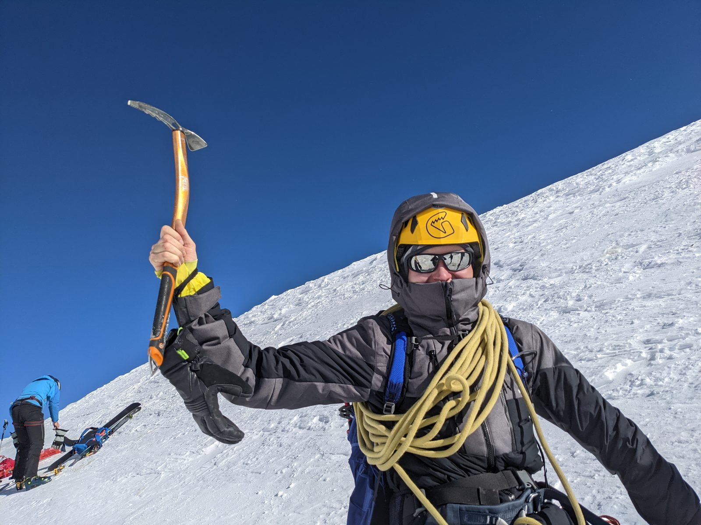
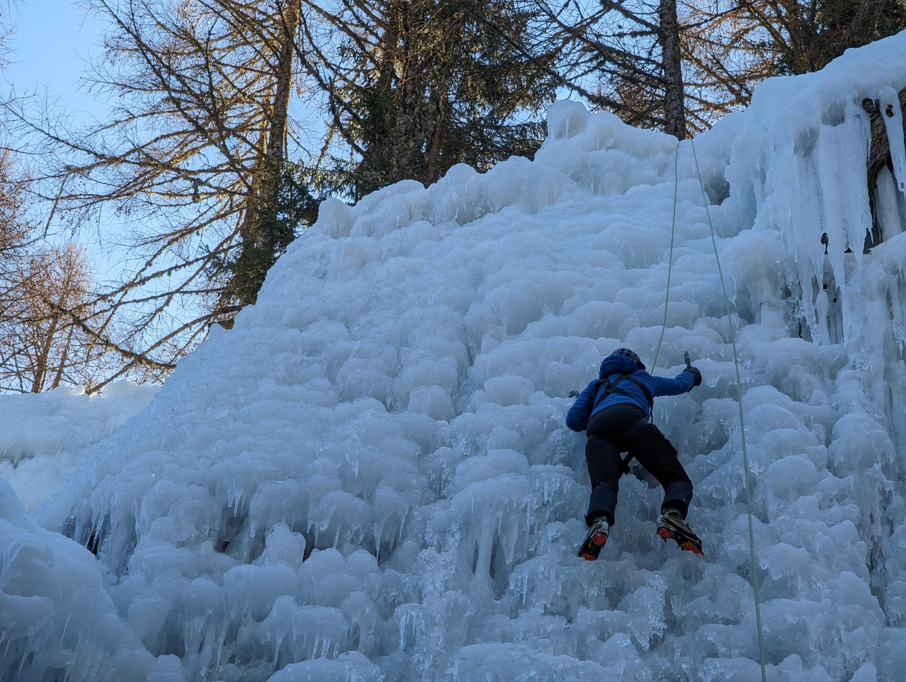
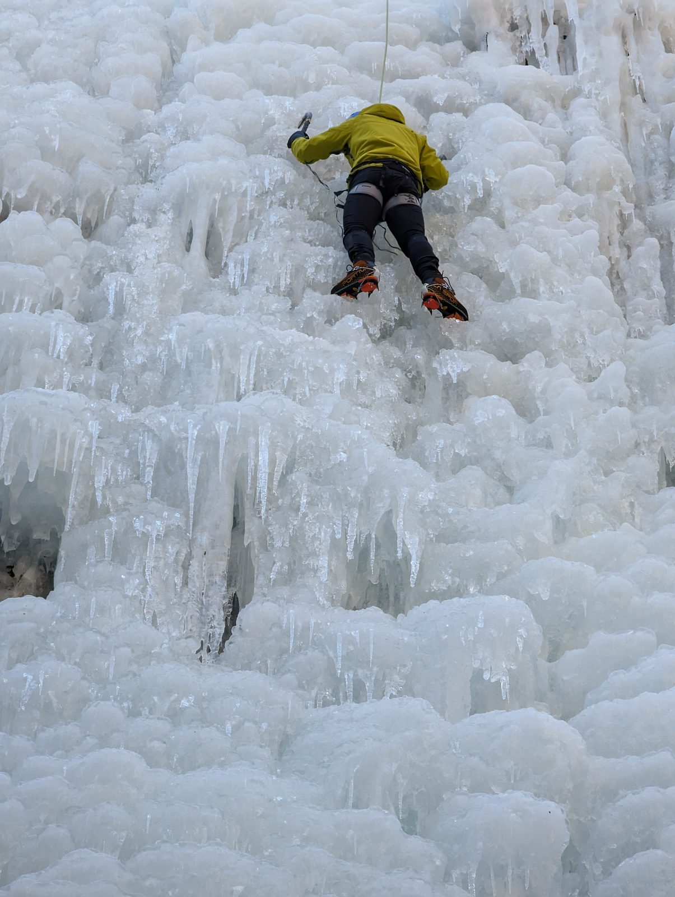
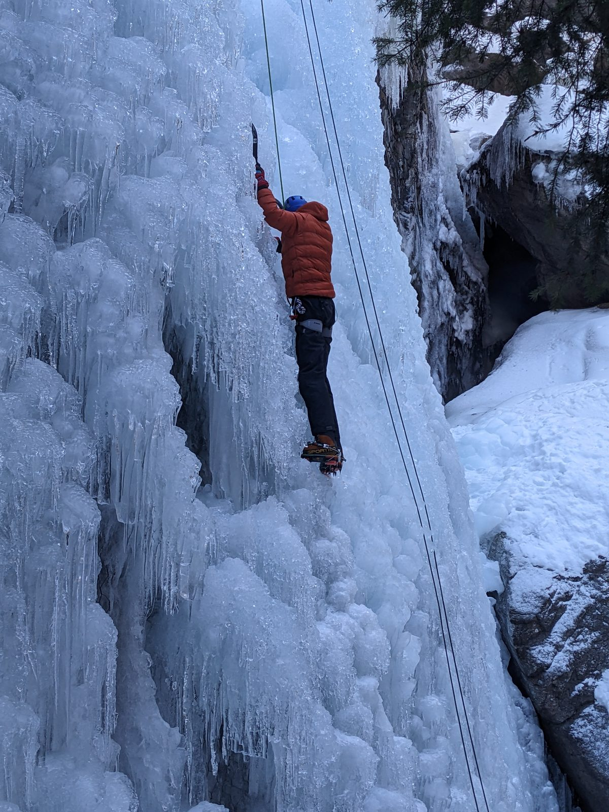
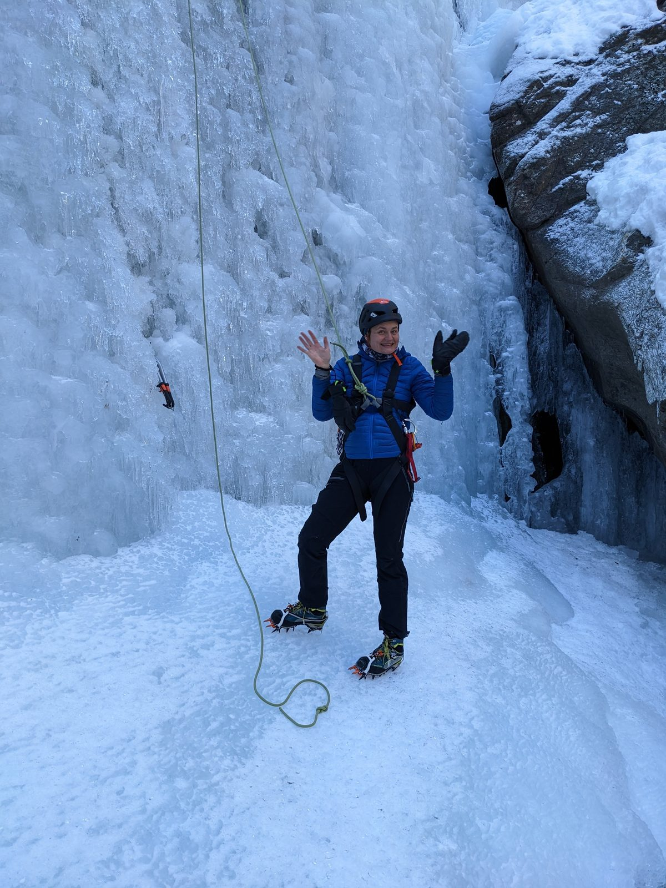

Minule jsem psala o [vodopádech](https://vendulasubert.cz/cs/outdoor/2026-10-03-canyoning/), dnes o ledopádech.

*foto: Led, smrky a modré nebe – Chamonix v únoru.*

Ledolezení, jak už napovídá sám název, znamená, že lezeme po ledopádu, což je většinou zmrzlý vodopád. Na skutečném ledopádu, který vytvořila příroda, si prvolezec zakládá jištění sám, nejčastěji ledovcové šrouby, a to je pomalé a úplně nevhodné pro začátečníky. Skutečné lezení na kusu vodopádu jsem si nikdy nezkusila. Je to jedna z věcí, ze kterých mám velký respekt.

Zkusili jsme si ale ledolezení na cvičné stěně. V údolí Chamonix je několik míst, kde v zimě francouzští guidi polévají kus skály vodou a nad ní připevňují jisticí oka. Je to jedna z mála příležitostí, kde si můžete ledolezení vyzkoušet relativně bezpečně.

*foto: Cvičná stěna: vlevo náš kamarád, vpravo Eda. Nahoře jsou oka uvázaná ke stromům, takže se leze s jištěním shora.*

## Jak se leze

Na rozdíl od klasického lezení tady nejde příliš o techniku prstů. Na nohách máte mačky, v rukou dva lezecké cepíny. Možná si představujete, že se cepínem seká do ledu, co to dá. Ve skutečnosti se do ledu spíš nezasekává a hledají se kapsy, o které se cepín dá zapřít. Zasekávání s rukou vysoko nad hlavou je recept na to, že do minuty máte ruku úplně odkrvenou.

*foto: Mačky, cepíny, tady se docela vysiluju: ideální je mít cepíny výše, ale to zase pak někdy umírají ruce.*

Nejhorší chvíle pro mě byly, když jsem nemohla najít dobrý chyt pro cepín. Po delším lezení mě ruka někdy bolela tak, že jsem ji s cepínem už nedokázala zvednout nahoru. A pustit cepín, když ho nemáte přidělaný k ruce, je kvůli lidem pod vámi fakt špatný nápad. Vlastně je možná špatný nápad mít cepín, který není přidělaný k ruce, vůbec (potící se smajlík).

Eda ledolezení dává rozhodně líp než já, protože má mnohem víc explozivní síly. Já se mu většinou vyrovnám nanejvýš ve vytrvalostních věcech nebo v plavání. Na ledu jsem musela dvacetkrát odpočívat, zatímco on stěnu vylezl najednou :D

## Co si obléct

Oblečení taky není úplně sranda. Když jistíte dole pod stěnou, je to ve stínu a bývá fakt šílená kosa. Když lezete kolmo nahoru, rychle se zpotíte. My jsme s Edou nakonec přišli na dvoubundové řešení. Funkční triko, mikina (pro některé i druhá mikina), termopodvlíkačky, na to zimní kalhoty na špagátu a lehčí péřová bunda. Takhle lezeme. Když dolezeme, navlékneme se do pořádných francouzských bund a těžkých zimních cyklistických rukavic, které mají kromě palce volný také ukazováček (hodí se pro manipulaci s lanem).

A samozřejmě přilba. Na cvičné stěně leze vedle sebe víc lidí a kusy ledu občas létají dolů.

*foto: Tahle fotka není z ledolezení, ale z Aiguille du Midi. Je na ní ale vidět ta pořádná francouzská bunda – do ní se po dolezení balím na jištění. Taky je vidět ta silná cyklistická rukavice.*

## Na stěně

A pak už je to krásné lezení odspoda nahoru.

*foto: Odspoda nahoru.*

*foto: Kamarád v rampouchách.*

*foto: Brácha na strmější části stěny.*

Vzali jsme s sebou i jednoho z mých bráchů a lezl velmi dobře. Myslím, že se trochu bál, ale nedal to najevo.

Na cvičné stěně je třeba lézt opatrně: když vytrhnete kus ledu, není to příjemné pro lidi pod vámi. Kdo na stěně, u které je hodně lidí, vykopává zbytečně moc ledu, toho francouzští guidi považují za bezohledníka. Ke konci zimy se navíc stěna umí rozpadat i sama. Mně se jednou utrhl kus stěny, zrovna když jsem byla asi dva a půl metru nad zemí a lano ještě nebylo dostatečně napnuté, takže jsem dopadla až na zem. Jistič se solidně vyděsil, protože ani jeden z nás to nečekal. O to větší respekt mám teď z lezení na skutečném ledopádu.

*foto: Zpátky dole, celá a spokojená.*

## Kam vyrazit

Jednou z cvičných stěn je [Cascade de glace de Bérard](https://reservation.chamonix-guides.com/reservation-cascade-de-glace-berard.html) ve Vallorcine, kousek od Chamonix, asi 10 minut pěšky od vlakové zastávky Le Buet. Vstup je zdarma a za 5 eur si můžete online zarezervovat místo. V sezóně se to vyplatí, protože se tam vejde jen 30 lidí, a když je plno, mají přednost ti s rezervací.

Guida nepotřebujete, ale potřebujete vlastní vybavení, lano (80 m) a umět jistit a pracovat s lanem. Boty, mačky a cepíny si můžete půjčit v některé z outdoorových prodejen v Chamonix. Lano a úvazek je ale lepší mít vlastní: u půjčeného jisticího vybavení nikdy nevíte, jak s ním zacházel ten před vámi, díky čemuž se moc nepůjčují.

Tak až budete mít cestu kolem Chamonix, ledolezení zdar!
