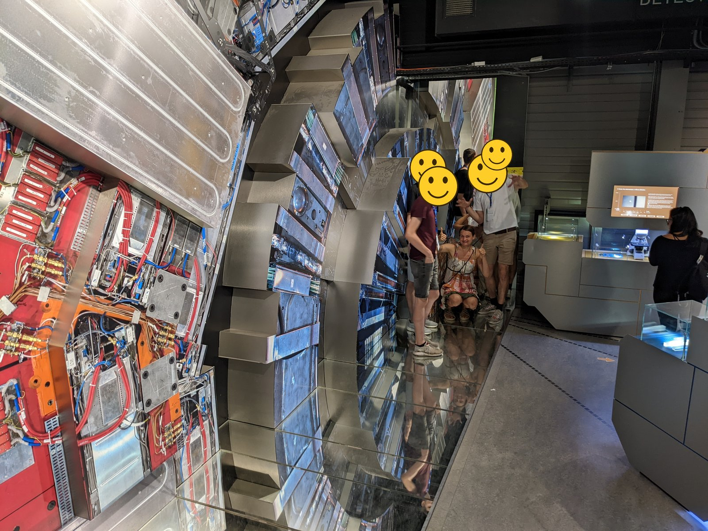
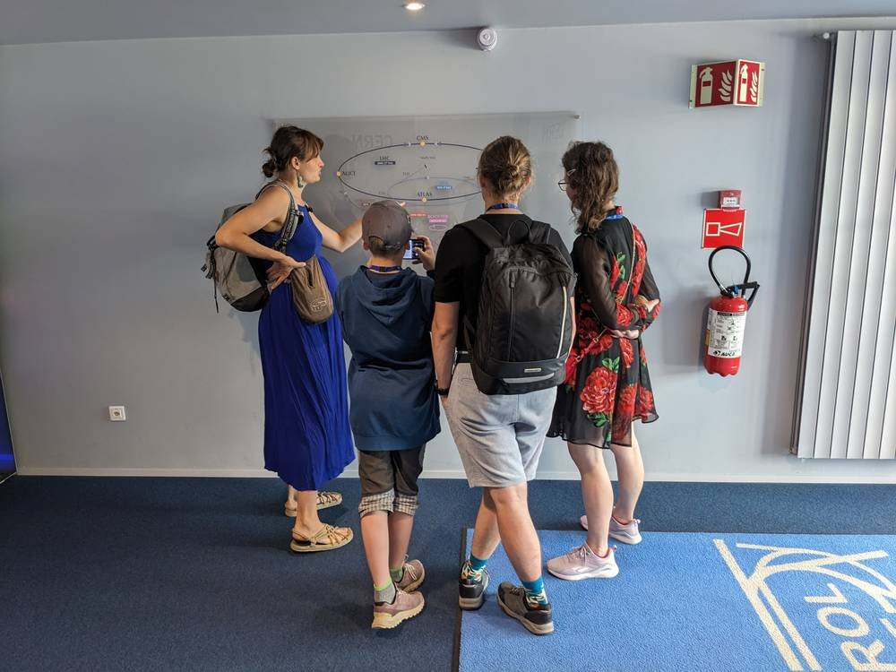
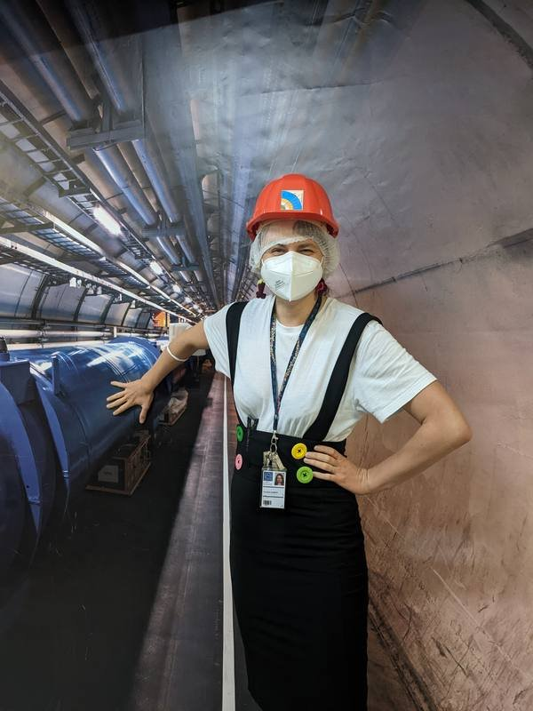
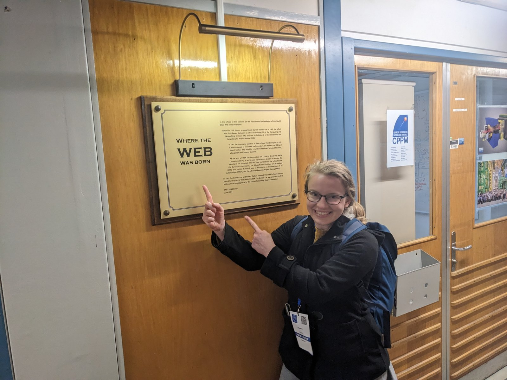
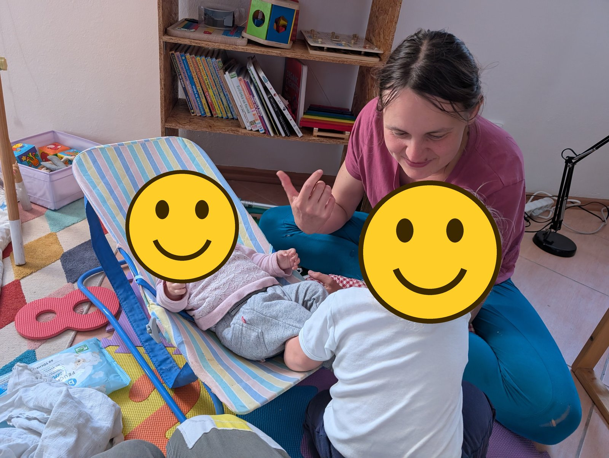

*foto: S bráchou u modelu detektoru CMS v bývalé výstavě v CERNu*

Na houpacím křesílku, které teď máme doma, si lebedil syn našich kamarádů z CERNu ve chvíli, kdy jim Tim Berners-Lee vyprávěl o svém nápadu na světový web. Kamarád mu prý tehdy řekl: „Zajímavý nápad, ale nemyslím si, že se to ujme.“ Když nám o mnoho let později křesílko předával pro naše novorozeně, dodal se smíchem: „Jak jsem se mýlil.“

Teď z něj vyrostla i naše nejmladší a křesílko může jít dál.
Teď se ale vraťme k tomu, proč tenhle článek píšu: zkusím pojem CERN trochu vysvětlit.

Co je podstata CERNu? Je to místo, kde fyzici píšou čmáranice na tabuli jako Sheldon ze seriálu Big Bang Theory? Nebo místo, kde se zkoumá jaderná fyzika (Bůh ví, co to znamená, ale v bondovkách vypadá důležitě) a skupina vědců každý den pracuje na tom, aby se předešlo katastrofě? Většina lidí má o CERNu jen mlhavou představu: něco s fyzikou, něco hodně důležitého. Zkusím ji trochu zaostřit.

CERN je evropská výzkumná organizace, kterou v roce 1954 založilo dvanáct států a sídlí u Ženevy, přímo na hranici Švýcarska a Francie. Zkratka pochází z francouzského názvu Evropská rada pro jaderný výzkum. CERN financují členské státy; Česko je členem od roku 1993 (Československo od roku 1992). Pracují tu tisíce zaměstnanců a k tomu přes deset tisíc vědců z univerzit a ústavů z celého světa, kteří sem jezdí dělat experimenty.

V CERNu jsem pracovala 3,5 roku a na ty roky vzpomínám moc ráda. Zkoumala jsem, jak moc se opotřebovávají a poškozují křemíkové části detektorů, o konkrétní náplni mojí práce plánuju napsat jiný blogpost. Ale také jsem dělala průvodkyni: návštěvníkům jsem ukazovala jednotlivé části komplexu a vysvětlovala, k čemu slouží.

## LHC je kladivo

Nejznámější částí CERNu je LHC, Velký hadronový urychlovač, tak začněme tam. LHC je ve své podstatě kladivo, které rozbíjí hmotu.

Proč by někdo chtěl rozbíjet hmotu? Představte si, že všechno na světě se dá uvařit ze 17 základních přísad. Nebo jinak: že všechno je postavené ze 17 druhů kostiček Lega. Takhle ve velmi zjednodušené metafoře popisují fyzici svět (17 je podle obvyklého počítání). Pro ty, kdo si pamatují ze střední školy trochu fyziky: mezi tyto základní přísady patří například elektron nebo neutrino. A abychom zjistili, z čeho se věci skládají, musíme je rozbít.

Tahle myšlenka není úplně nová. Na začátku 19. století přišel John Dalton s teorií, že existuje spousta typů základních dílků – atomů (například atom vodíku nebo atom kyslíku), ze kterých se dá všechno postavit (třeba voda v případě těchto dvou prvků). Chemici se tehdy snažili rozbíjet látky, které máme kolem sebe, a získávat z nich prvky. Jejich kladivem na hmotu byl chemický experiment.

Prvky se nejprve řadily do triád, poté do oktáv a nakonec je Mendělejev uspořádal do tabulky.

Jsou ale atomy opravdu těmi základními, nedělitelnými přísadami všeho? Samo slovo atom znamená řecky „nedělitelný“. Jenže některé prvky měly podobné vlastnosti, což naznačovalo, že mají nějakou společnou vnitřní strukturu. (Pokud jsme došli k tomu, že mezi základní jednotky jídla patří ovoce, zelenina, bábovky a bonbóny, pak nás společná sladká chuť bábovky, bonbónu a ovoce může dovést k myšlence, že obsahují cosi společného, totiž něco, co způsobuje sladkost.)

Prvním dílkem, který se našel uvnitř atomu, byl elektron. J. J. Thomson v roce 1897 zkoumal katodové paprsky, které vylétají z kovové elektrody ve vakuové trubici, a změřil poměr jejich náboje a hmotnosti. Ať použil jakýkoli kov, vycházel pořád stejně, a navíc ukazoval, že tyhle částice jsou víc než tisíckrát lehčí než nejlehčí atom. Nejjednodušší vysvětlení bylo, že jde o kousíček, který v sobě mají atomy všech kovů – a možná všechny atomy vůbec. Atom tedy nedělitelný není. Jako by se ukázalo, že cukr z bábovky, z bonbónu i z jablka vytváří na našem jazyku stejnou sladkost.

Elektrony ale tvoří jen nepatrnou část hmotnosti atomu. Kde je zbytek? To zjistil Ernest Rutherford: v roce 1911 vysvětlil pokus, při kterém se tenká zlatá fólie ostřelovala částicemi alfa. Většina jich fólií prolétla, ale pár se odrazilo zpátky – Rutherford to přirovnal k dělostřeleckému granátu, který se odrazí od papíru. Skoro všechna hmota atomu tedy musí být soustředěná v nepatrném jádru uprostřed. S novým fyzikálním kladivem, jadernou fyzikou, se pak podařilo rozbít i jádro a zjistit, že se skládá z protonů a neutronů.

Pak na scénu nastoupily velké laboratoře – CERN, SLAC, DESY a další – a s nimi kladivo, které se jmenuje částicová fyzika. Princip je jednoduchý: urychlit dvě částice na co nejvyšší energii a nechat je do sebe narazit. (Rychlost se přitom blíží rychlosti světla, ale nikdy ji nedosáhne – při dalším urychlování roste hlavně energie částic.) Dříve se srážely například protony s antiprotony nebo elektrony s pozitrony, dnes se v LHC urychlují protony a příležitostně také těžká jádra olova. Trochu jako kdybyste hodili autíčkem o stěnu: z dochovaných úlomků se můžete dozvědět, jak vypadalo autíčko uvnitř.

Tady ale metafora kulhá. Při srážce protonů se mezi úlomky objevují i částice, které v protonu vůbec nebyly – jako by se po nárazu dvou autíček mezi trosky vysypal náklaďák. Přesně tak vznikl Higgsův boson: v protonu schovaný nebyl, vyrobil se z energie srážky. Einsteinovo E = mc² říká, že energie a hmotnost jsou dvě podoby téhož, takže energii srážky lze „přetavit“ na novou hmotu. Čím těžší částici chceme vyrobit, tím víc energie musíme do srážky dodat – a Higgsův boson je asi 130krát těžší než proton. Proto fyzici chtějí čím dál silnější urychlovače: s vyšší energií mohou vznikat těžší částice, které jsme zatím nikdy neviděli.

## Proč tak hrubě? A proč ne neutrony?

Na tomto místě mohou čtenáře napadnout dvě otázky. Není to trochu hrubá metoda? Nebylo by lepší autíčka a protony pěkně rozšroubovat a podívat se, co je uvnitř? A druhá: proč srážíme jen protony a elektrony? Nebylo by dobré urychlit také neutrony a nechat je do sebe narazit?

Odpověď je podobná:

1. Nemáme dobrý fyzikální šroubovák, který by umožňoval zkoumat vnitřní složení atomů v klidu.
2. Nemáme fyzikální ovladač na neutrony. Protony a elektrony dokážeme urychlit, zpomalit a přesměrovat, protože jsou nabité. Neutrony elektrický náboj nemají, a tak s nimi takhle manipulovat nedokážeme.

## Urychlovací kolečka

Abychom protony dostali na energii, při které se v LHC srážejí, nestačí jeden urychlovač. Proč vlastně kolečka? První urychlovače byly lineární: částice proletěla řadou urychlovacích úseků jednou za sebou a tím to skončilo. Kdo chtěl vyšší energii, musel stavět delší a delší trubku. Kruhový urychlovač ten problém obchází: silné magnety ohýbají dráhu částic do kruhu, takže proletí stejnými urychlovacími úseky znovu a znovu – v LHC přes jedenáct tisíc krát za sekundu – a při každém oběhu dostanou malé postrčení.

Každé kolečko ale funguje dobře jen v určitém rozsahu energií, a tak si částice předávají štafetu.

*foto: Mapa urychlovačů byla při prohlídkách moje oblíbená zastávka – bez ní se v té štafetě nikdo nevyzná. Na fotce mě poslouchá i Olga, která o vědě (chemii) natáčí kanál [Olinium](https://www.youtube.com/@Olinium).*

Cesta protonu začíná v obyčejné lahvi s vodíkem. Z vodíku se nejprve udělají ionty H⁻ – atomy vodíku s jedním elektronem navíc – a ty se rozběhnou v lineárním urychlovači **Linac4**, rovné trubce dlouhé necelých sto metrů. Na jejím konci proletí tenkou fólií, která z nich strhne oba elektrony, a zbydou holé protony. Ty pokračují do prvního kolečka, **PS Booster** (157 metrů obvodu), pak do **PS**, Protonového synchrotronu (628 metrů), a dál do **SPS**, Super protonového synchrotronu (necelých 7 km). Každé kolečko protony urychlí o kus víc a předá je dalšímu. Nakonec skončí ve 27 km dlouhém **LHC**, kde krouží jen o vlásek pomaleji než světlo.

V LHC se protony pošlou tak, že část obíhá v jednom směru a část v druhém. Na čtyřech místech se pak oba svazky nasměrují proti sobě, aby se srazily.

V tuhle chvíli se v CERNu mluví o možném přidání dalšího kolečka, FCC, které by mělo kolem 91 kilometrů a vedlo by pod Švýcarskem a Francií.

## Čtyři obří fotoaparáty

V místech srážek stojí čtyři gigantické „fotoaparáty“ – detektory, které srážky zachycují: **ATLAS, CMS, ALICE a LHCb**. ATLAS je vysoký jako osmipatrový dům a CMS váží víc než Eiffelovka. Detektor obklopuje místo srážky ve vrstvách jako cibule a každá vrstva zachytí něco jiného: kudy částice proletěla, jakou měla energii, jaký měla náboj. Z toho se pak dá zpětně poskládat, co se při srážce stalo.

Detektor ale není fotoaparát, který si v klidu fotí z bezpečné vzdálenosti. Sedí přímo u srážek a je jimi neustále ostřelovaný. Podstatou mojí práce bylo zkoumat, jak záření poškozuje křemíkové senzory v detektorech. Fyzikálně se tomu říká neionizační energetické ztráty (NIEL). Lidsky řečeno: fotoaparát, který fotí výbuchy, je těmi výbuchy pomalu ničen. A někdo musí spočítat, jak dlouho vydrží a jak moc se každým výbuchem poničí.

Do jeskyně ATLASu se dá podívat jen tehdy, když je urychlovač odstavený. Tady jsou videa z mojí návštěvy podzemního prostoru ATLASu.

<iframe src="https://www.youtube-nocookie.com/embed/FdtB1gqnA-g" title="Pohled z lešení na bok ATLASu" loading="lazy" allowfullscreen style="display:block;width:100%;max-width:360px;aspect-ratio:9/16;border:0;margin:0 auto;"></iframe>

*video: pohled z lešení na bok ATLASu: mionové komory, nosná konstrukce a nekonečné kabely*

<iframe src="https://www.youtube-nocookie.com/embed/6DUhvsb2b3o" title="Procházka po lávkách na detektoru ATLAS" loading="lazy" allowfullscreen style="display:block;width:100%;max-width:360px;aspect-ratio:9/16;border:0;margin:0 auto;"></iframe>

*video: procházka po lávkách na detektoru ATLAS: mezi barelovými mionovými komorami je vidět až na dno jeskyně*

*foto: Já před plakátem urychlovače za covidu*

Data z detektorů pak analyzuje celá armáda analytiků a dedukuje z nich základní složení vesmíru. V CERNu takto přišli na tři z těch kostiček Lega: W boson a Z boson (1983) a Higgsův boson (2012).

## Kde se narodil web

Takto obrovský komplex přitahuje vědce z celého světa, kteří pracují na nejrůznějších problémech. Tady vznikl například světový web – a tady se odehrála i historka s křesílkem z úvodu.

*foto: Moje kamarádka Bára Miklasová ukazuje na ceduli na chodbě, kde se zrodil web. Bára mimochodem rediguje moji chystanou knížku.*

## Co z toho máme

CERN taky vyvíjí technologie, které se dostaly do nemocnic. V roce 1977 tu vznikl jeden z prvních PET snímků. Čipy vyvinuté pro detektory LHC umí rentgen „vidět barevně“. Podle návrhu urychlovače z CERNu dnes v Itálii a Rakousku léčí rakovinu protony a ionty uhlíku. Zařízení MEDICIS vyrábí vzácné radioizotopy, na kterých nemocnice zkoušejí nové způsoby diagnostiky a léčby. Detektory z CERNu měří záření na ISS. A na cestě k tomu všemu se lidstvo naučilo stavět supravodivé magnety, chladit hromadu magnetů na teplotu nižší než ve vesmíru a sdílet data přes celý svět. Mimochodem právě proto vznikl web.

V přepočtu na obyvatele posílá Česko na fungování CERNu přibližně 35–40 Kč ročně. CERN se to snaží vrátit tím, že produkuje open-source technologie a software, které se pak používají v dalším výzkumu. Vědě zdar!

## A co křesílko?

*foto: Křesílko, které poslouchalo sira Tima, když přišel s nápadem na world wide web. Na fotce v něm sedí naše nejmladší.*

Teď hledá nový domov – ideálně u někoho, kdo má malé dítě a rád si o tom bude vyprávět. Je už hodně staré, ale o to lepší má příběh. Bydlí u nás v Českém ráji a předáme ho osobně. Pokud byste o něj měli zájem, ozvěte se mi na maulerova@gmail.com. Zn. zadarmo jsme dostali, zadarmo dáme :)
