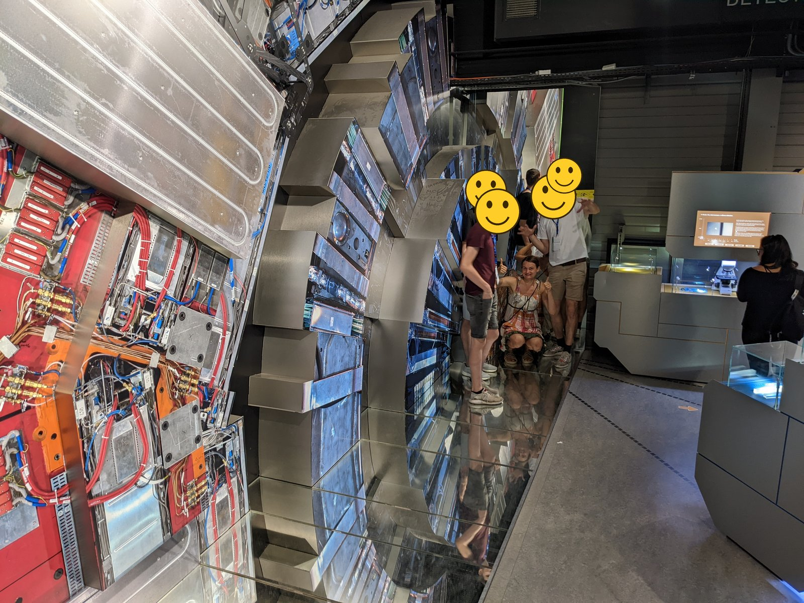
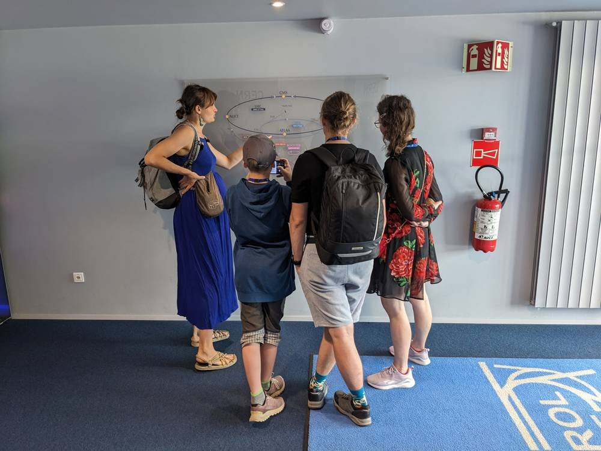
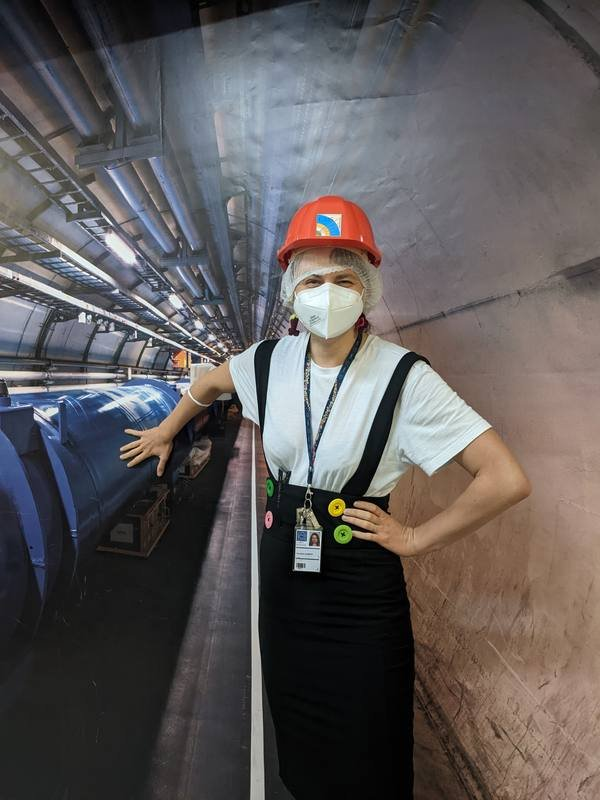
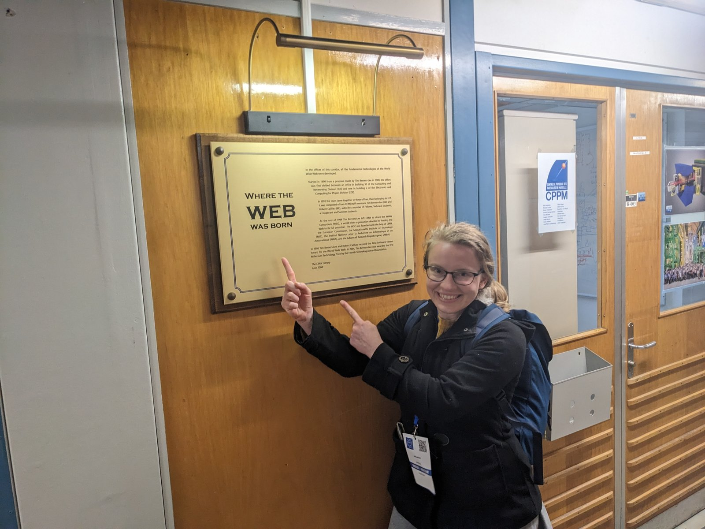
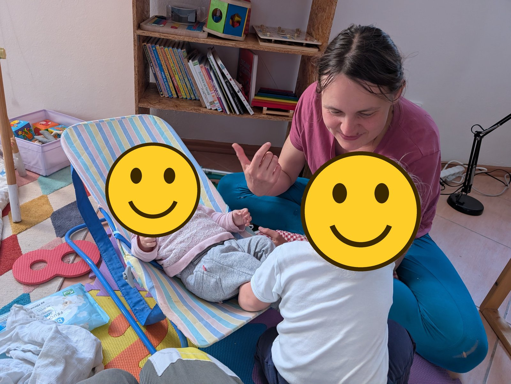

*photo: With my brother at a model of the CMS detector in a former CERN exhibition*

The rocking chair we now have at home is the one our CERN friends' son used to sprawl in, right when Tim Berners-Lee was telling them about his idea for the world wide web. Our friend apparently told him at the time: "Interesting idea, but I don't think it'll catch on." Years later, when he handed the chair over for our newborn, he added with a laugh: "How wrong I was."

Now our youngest has outgrown it too, and the chair is ready to move on.
Now, though, let's get back to why I'm actually writing this post: I'll try to explain the term CERN a little.

What is CERN, really? A place where physicists scrawl equations on a whiteboard like Sheldon from The Big Bang Theory? Or somewhere nuclear physics gets studied (God knows what that actually means, but it sounds important in Bond movies) and a team of scientists works every day to prevent some kind of catastrophe? Most people, I'd say, have only a hazy idea of CERN: something to do with physics, something very important. Let me try to bring that into focus a bit.

CERN is a European research organization founded in 1954 by twelve countries, based near Geneva, right on the border between Switzerland and France. The acronym comes from its French name, the European Council for Nuclear Research. CERN is funded by its member states; Czechia has been a member since 1993 (Czechoslovakia since 1992). Thousands of staff work here, plus more than ten thousand scientists from universities and institutes around the world who come to run experiments.

I worked at CERN for three and a half years, and I look back on them very fondly. I studied how much wear and radiation damage silicon parts of detectors take — I'm planning a separate post about the actual substance of my work. But I also worked as a guide, showing visitors around the different parts of the complex and explaining what they were for.

## The LHC is a hammer

The most famous part of CERN is the LHC, the Large Hadron Collider, so let's start there. At its core, the LHC is a hammer that smashes matter.

Why would anyone want to smash matter? Imagine that everything in the world could be cooked up from 17 basic ingredients. Or put differently: that everything is built out of 17 kinds of Lego brick. That's the very simplified metaphor physicists use to describe the world (17, by the usual count). For anyone who remembers a bit of high-school physics: the electron and the neutrino are among these basic ingredients. And to find out what things are made of, we have to break them apart.

This idea isn't exactly new. In the early 19th century, John Dalton proposed a theory that there are many types of basic building blocks — atoms (say, a hydrogen atom or an oxygen atom) — that everything else can be built from (water, in the case of those two elements). Chemists at the time tried to break apart the substances around us and extract elements from them. Their hammer for matter was the chemical experiment.

Elements were first sorted into triads, then octaves, and eventually Mendeleev arranged them into a table.

But are atoms really the basic, indivisible ingredients of everything? The word "atom" literally means "indivisible" in Greek. Yet some elements had similar properties, which suggested they shared some common inner structure. (If we've decided that fruit, vegetables, cake, and candy are the basic units of food, then the shared sweetness of cake, candy, and fruit might lead us to suspect they contain something in common — something that causes sweetness.)

The first piece found inside the atom was the electron. In 1897, J. J. Thomson studied cathode rays flying out of a metal electrode in a vacuum tube, and measured the ratio of their charge to their mass. Whatever metal he used, the result came out the same, and it also showed these particles were more than a thousand times lighter than the lightest atom. The simplest explanation was that this was a tiny piece shared by the atoms of every metal — and maybe by all atoms, period. So the atom isn't indivisible after all. As if it turned out that the sugar in cake, in candy, and in an apple all produced exactly the same sweetness on our tongue.

But electrons only account for a tiny fraction of an atom's mass. So where's the rest? Ernest Rutherford found out: in 1911, he explained an experiment in which a thin sheet of gold foil was bombarded with alpha particles. Most of them flew straight through the foil, but a few bounced straight back — Rutherford compared it to an artillery shell bouncing off a piece of paper. So almost all of an atom's mass had to be concentrated in a tiny nucleus at its center. With a new physics hammer, nuclear physics, people then managed to crack open the nucleus too, and found it's made of protons and neutrons.

Then the big laboratories arrived on the scene — CERN, SLAC, DESY, and others — bringing with them a hammer called particle physics. The principle is simple: accelerate two particles to the highest possible energy and let them collide. (Their speed gets closer and closer to the speed of light but never quite reaches it — further acceleration mostly just raises the particles' energy instead.) In the past, that meant colliding, say, protons with antiprotons, or electrons with positrons; today the LHC accelerates protons, and occasionally heavy lead nuclei too. It's a bit like throwing a toy car at a wall: from the surviving fragments, you can work out what the car looked like inside.

Here, though, the metaphor starts to limp. When protons collide, particles show up among the fragments that were never inside the proton in the first place — as if a truck spilled out of the wreckage after two toy cars crashed into each other. That's exactly how the Higgs boson came about: it wasn't hiding inside the proton, it was created from the energy of the collision. Einstein's E = mc² tells us that energy and mass are two forms of the same thing, so the energy of a collision can be "melted down" into new matter. The heavier the particle we want to create, the more energy we need to put into the collision — and the Higgs boson is about 130 times heavier than a proton. That's why physicists want ever more powerful accelerators: higher energy can produce heavier particles we've never seen before.

## Why so crude? And why not neutrons?

At this point, two questions might occur to you. Isn't this a rather crude method? Wouldn't it be better to carefully unscrew the toy cars and protons and look inside? And second: why do we only smash protons and electrons together? Wouldn't it be good to accelerate neutrons too, and let them collide?

The answer is similar either way:

1. We don't have a good physics screwdriver that would let us examine the inner structure of atoms at rest.
2. We don't have a physics remote control for neutrons. We can accelerate, slow down, and redirect protons and electrons because they're charged. Neutrons carry no electric charge, so we can't manipulate them that way.

## Rings of accelerators

Getting protons up to the energy at which they collide in the LHC takes more than one accelerator. So why rings at all? The first accelerators were linear: a particle flew through a row of accelerating sections once, and that was it. Anyone who wanted higher energy had to build a longer and longer pipe. A circular accelerator gets around that problem: strong magnets bend the particles' path into a circle, so they fly through the same accelerating sections over and over — in the LHC, more than eleven thousand times a second — getting a small push with every lap.

Each ring, though, only works well within a certain range of energies, so the particles get passed along in a relay.

*photo: The accelerator map was my favorite stop on tours — without it, nobody can make sense of that relay race. In the photo, Olga, who makes science (chemistry) videos for the channel [Olinium](https://www.youtube.com/@Olinium), is listening in too.*

A proton's journey starts in an ordinary bottle of hydrogen. The hydrogen is first turned into H⁻ ions — hydrogen atoms with one extra electron — which set off into the linear accelerator **Linac4**, a straight pipe just under a hundred meters long. At its end, they fly through a thin foil that strips off both electrons, leaving bare protons. These continue into the first ring, the **PS Booster** (157 meters around), then the **PS**, the Proton Synchrotron (628 meters), and on into the **SPS**, the Super Proton Synchrotron (just under 7 km). Each ring accelerates the protons a bit further and hands them on to the next. Finally, they end up in the 27-km-long **LHC**, where they circle just a hair slower than light.

In the LHC, the protons are sent around so that part of the beam circles one way and part the other. At four points, the two beams are then steered into each other so they collide.

Right now CERN is talking about possibly adding another ring, the FCC, which would be around 91 kilometers and would run underneath Switzerland and France.

## Four giant cameras

At the collision points stand four gigantic "cameras" — detectors that capture the collisions: **ATLAS, CMS, ALICE, and LHCb**. ATLAS is as tall as an eight-story building, and CMS weighs more than the Eiffel Tower. A detector surrounds the collision point in layers, like an onion, and each layer picks up something different: which way a particle flew, how much energy it had, what charge it carried. From that, you can piece together what happened in the collision.

A detector isn't a camera calmly shooting from a safe distance, though. It sits right next to the collisions and gets constantly bombarded by them. The core of my work was studying how radiation damages the silicon sensors inside detectors. In physics, that's called non-ionizing energy loss (NIEL). In human terms: a camera that photographs explosions is slowly destroyed by those very explosions. And someone has to calculate how long it'll last, and how much damage each explosion does.

You can only look into the ATLAS cavern when the accelerator is shut down. Here are some videos from my visit to the underground ATLAS cavern.

<iframe src="https://www.youtube-nocookie.com/embed/FdtB1gqnA-g" title="View from the scaffolding onto the side of ATLAS" loading="lazy" allowfullscreen style="display:block;width:100%;max-width:360px;aspect-ratio:9/16;border:0;margin:0 auto;"></iframe>

*video: view from the scaffolding onto the side of ATLAS: muon chambers, the support structure, and endless cables*

<iframe src="https://www.youtube-nocookie.com/embed/6DUhvsb2b3o" title="Walking the walkways on the ATLAS detector" loading="lazy" allowfullscreen style="display:block;width:100%;max-width:360px;aspect-ratio:9/16;border:0;margin:0 auto;"></iframe>

*video: walking the walkways on the ATLAS detector: between the barrel muon chambers you can see all the way down to the bottom of the cavern*

*photo: Me in front of an accelerator poster, during covid*

An entire army of analysts then processes the data from these detectors and deduces the basic makeup of the universe from it. That's how CERN found three of those Lego bricks: the W and Z bosons (1983) and the Higgs boson (2012).

## Where the web was born

A complex this enormous attracts scientists from all over the world, working on all sorts of problems. The world wide web was born here, too — and that's also where the rocking-chair story from the intro took place.

*photo: My friend Bára Miklasová pointing at the plaque in the corridor where the web was born. Incidentally, Bára is editing my upcoming book.*

## What we get out of it

CERN also develops technologies that have made their way into hospitals. One of the first PET scans was made here in 1977. Chips developed for the LHC's detectors let X-rays "see in color." Based on a CERN accelerator design, proton and carbon-ion beams are now used to treat cancer in Italy and Austria. The MEDICIS facility produces rare radioisotopes that hospitals test out in new diagnostic and treatment methods. CERN-built detectors measure radiation on the ISS. And along the way to all of this, humanity learned how to build superconducting magnets, cool a mountain of magnets to temperatures colder than outer space, and share data across the whole world — which, incidentally, is exactly why the web was invented in the first place.

Per capita, Czechia sends roughly 35–40 CZK (about €1.50) a year toward running CERN. CERN tries to give that back by producing open-source technologies and software that then get used in further research. Hooray for science!

## And what about the chair?

*photo: The rocking chair that listened to Sir Tim when he came up with the idea for the world wide web. In the photo, our youngest is sitting in it.*

It's now looking for a new home — ideally with someone who has a small child and will enjoy telling this story themselves. It's very old by now, but that just makes for a better story. It lives with us in the Český ráj (Bohemian Paradise) region, and we'll hand it over in person. If you're interested, drop me a line at maulerova@gmail.com. PS: we got it for free, we're giving it away for free too :)
